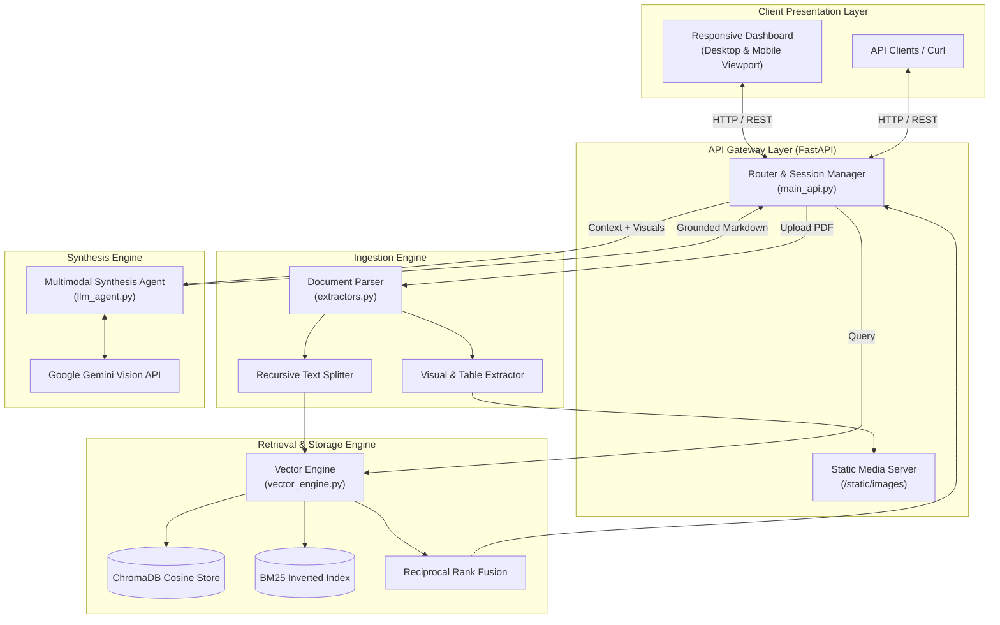
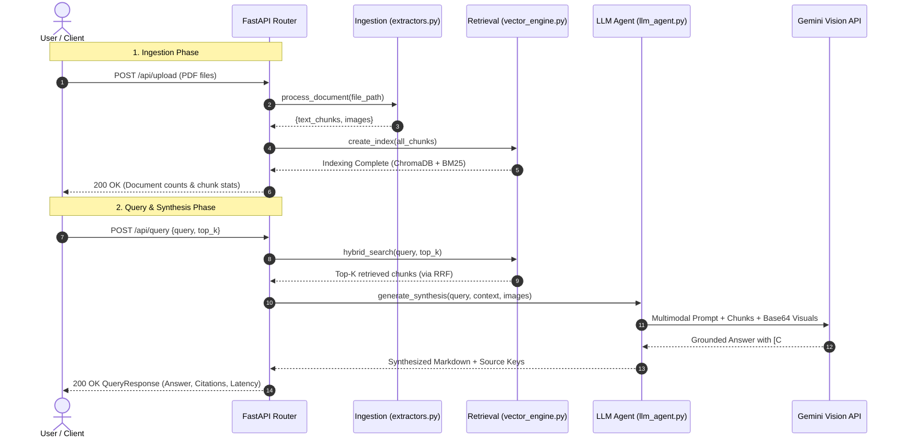

# Synthexis

[](https://www.python.org/)
[](https://fastapi.tiangolo.com/)
[](https://www.trychroma.com/)
[](https://ai.google.dev/)
[](https://tailwindcss.com/)
[](https://opensource.org/licenses/MIT)

**Synthexis** is an enterprise-grade, decoupled **Multi-Modal Retrieval-Augmented Generation (RAG)** platform designed to ingest complex multi-format documents, isolate embedded diagrams and data tables, perform hybrid lexical-semantic retrieval with Reciprocal Rank Fusion (RRF), and synthesize evidence-grounded answers using multimodal Large Language Models.

---

## 📑 Table of Contents
- [Key Features](#-key-features)
- [System Architecture](#-system-architecture)
- [Tech Stack](#-tech-stack)
- [End-to-End Pipeline Workflow](#-end-to-end-pipeline-workflow)
- [Directory Structure](#-directory-structure)
- [Installation & Setup](#-installation--setup)
- [Running the Platform](#-running-the-platform)
- [REST API Reference](#-rest-api-reference)
- [User Interface](#-user-interface)
- [Security & Hardening](#-security--hardening)
- [Important Remarks & AI Disclaimer](#-important-remarks--ai-disclaimer)
- [License](#-license)

---

## ✨ Key Features

- **Multi-Modal Document Extraction**: Parses complex PDFs, extracts text chunks with structural page markers, extracts structured Markdown tables, and isolates high-resolution diagrams, flowcharts, and technical charts as image payloads.
- **Hybrid Dense-Sparse Retrieval**: Combines dense semantic vector embeddings (`all-MiniLM-L6-v2` via ChromaDB) with sparse lexical keyword matching (`BM25Okapi`).
- **Reciprocal Rank Fusion (RRF)**: Merges sparse keyword matches and dense vector distances using rank-fusion mathematics ($k=60$) to eliminate technical term degradation.
- **Strict Citation Grounding**: The synthesis engine maps claims directly to source evidence using discrete citation tags (`[C1]`, `[C2]` for text chunks, `[V1]`, `[V2]` for visual figures) alongside an explicit source key.
- **Intelligent Knowledge Fallback**: When queries reference information not present in the ingested documents, the system explicitly informs the user of the omission before providing verified insights from external general knowledge.
- **Unified Responsive Workspace**: A single-page web dashboard that adapts dynamically across desktop monitors, tablets, and mobile devices without requiring separate routes or page reloads. Includes Spotlight Search (`⌘K` / `Ctrl+K`), an off-canvas Document Vault, and a Slide-over Evidence Inspector.

---

## 🏛️ System Architecture

Synthexis is built on a strictly decoupled service architecture:



---

## 💻 Tech Stack

| Domain | Technologies & Libraries | Purpose |
| :--- | :--- | :--- |
| **API & Server** | `FastAPI`, `Uvicorn`, `Pydantic v2`, `Starlette` | High-performance asynchronous REST API gateway, request validation, and static asset serving. |
| **Document Processing** | `PyMuPDF (fitz)`, `pdfplumber`, `LangChain Text Splitters` | High-fidelity text extraction, page metadata tagging, table extraction to Markdown, and diagram extraction. |
| **Vector Database** | `ChromaDB` (Persistent DuckDB + HNSW) | Local on-disk persistent vector database utilizing cosine distance space (`hnsw:space: cosine`). |
| **Dense Embeddings** | `SentenceTransformers` (`all-MiniLM-L6-v2`) | Local 384-dimensional dense semantic embedding generation with snapshot caching. |
| **Sparse Retrieval** | `rank-bm25 (BM25Okapi)` | Exact keyword inverted indexing preserving alphanumeric terms, error codes, and technical metrics. |
| **Reasoning & AI** | `google-genai` SDK, Google Gemini Vision | Multimodal reasoning, cross-document analysis, citation grounding, and fallback synthesis. |
| **User Interface** | HTML5, Tailwind CSS, Google Material Symbols, Geist & Inter fonts | Distraction-free, responsive single-page web application featuring Spotlight Search (`⌘K`) and slide-over drawers. |
| **Configuration** | `python-dotenv` | Centralized environment variable and secret management. |

---

## 🔄 End-to-End Pipeline Workflow



### Detailed Execution Stages:
1. **Document Ingestion**:
   - Uploaded PDF files are staged in the `data/uploads/` directory.
   - Text is parsed page-by-page, retaining document provenance (`[filename | Page X]`).
   - Text is split into semantic segments using recursive character splitting.
   - Embedded diagrams and visual figures are isolated, base64-encoded, and cataloged.
2. **Hybrid Indexing**:
   - Chunks are vectorized into 384-dimensional dense embeddings using `all-MiniLM-L6-v2`.
   - Embeddings are persisted to ChromaDB with cosine distance indexing.
   - In parallel, chunks are tokenized into an in-memory `BM25Okapi` inverted index.
3. **Hybrid Search & Reciprocal Rank Fusion (RRF)**:
   - When a search query arrives, it executes against both ChromaDB (dense semantic search) and BM25 (sparse keyword search).
   - Results are blended using Reciprocal Rank Fusion:
     $$\text{RRF\_Score}(d) = \sum_{m \in \{\text{dense}, \text{sparse}\}} \frac{w_m}{60 + \text{rank}_m(d)}$$
4. **Multimodal LLM Synthesis**:
   - The top-$K$ chunks and associated visual images are formatted with immutable evidence tags (`[C1]`, `[V1]`).
   - The prompt directs Google Gemini to synthesize a structured Markdown response adhering strictly to the evidence.
   - If the requested concept is absent from the documents, the model explicitly acknowledges the absence and provides the answer using general external knowledge.

---

## 📂 Directory Structure

```
Synthexis/
├── app.py                  # Streamlit alternative wrapper
├── main_api.py             # Primary FastAPI backend router & web server
├── extractors.py           # Document ingestion & multi-modal extractor
├── vector_engine.py        # ChromaDB vector store & BM25 hybrid search
├── llm_agent.py            # Gemini multimodal AI reasoning agent
├── index.html              # Responsive single-page web application
├── style.css               # Styling definitions and theme rules
├── requirements.txt        # Python dependency manifest
├── Dockerfile              # Containerization definition
├── docker-compose.yml      # Multi-service container orchestration
├── .env.example            # Environment configuration template
├── .gitignore              # Git ignore rules (protects .env and data caches)
└── data/                   # Persistent storage directory
    ├── chromadb/           # ChromaDB local vector database files
    ├── extracted_images/   # Extracted document diagrams & figures
    └── uploads/            # Staged PDF source documents
```

---

## 🛠️ Installation & Setup

### 1. Prerequisites
- **Python 3.10** or higher
- **pip** package manager
- A **Google Gemini API Key** (obtainable from [Google AI Studio](https://aistudio.google.com/))

### 2. Clone Repository
```bash
git clone https://github.com/Astroidkiller/Synthexis.git
cd Synthexis
```

### 3. Create a Virtual Environment
```bash
# Windows (PowerShell)
python -m venv venv
.\venv\Scripts\Activate.ps1

# Linux / macOS
python3 -m venv venv
source venv/bin/activate
```

### 4. Install Dependencies
```bash
pip install -r requirements.txt
```

### 5. Configure Environment Variables
Create a `.env` file in the project root:
```env
# Required: Google Gemini API Key
GEMINI_API_KEY=your_gemini_api_key_here

# Optional: Preferred model selection (defaults to gemini-flash-lite-latest)
GEMINI_MODEL=gemini-flash-lite-latest
GEMINI_FALLBACK_MODELS=gemini-3.8-flash,gemini-3.5-flash-lite

# Optional: Local embedding model cache override
# SYNTHEXIS_EMBEDDING_MODEL=sentence-transformers/all-MiniLM-L6-v2
```

---

## 🚀 Running the Platform

### Option A: Direct Web Application (Recommended)
Start the unified FastAPI server:
```bash
python -m uvicorn main_api:app --host 127.0.0.1 --port 8000 --reload
```
- **Web Dashboard**: Access the responsive application at **[http://localhost:8000](http://localhost:8000)**.
- **Interactive Swagger Docs**: View and test the REST API at **[http://localhost:8000/docs](http://localhost:8000/docs)**.

### Option B: Streamlit Runner
If running through Streamlit:
```bash
# Terminal 1: Start backend
python -m uvicorn main_api:app --host 127.0.0.1 --port 8000

# Terminal 2: Start Streamlit UI
streamlit run app.py
```
- **Streamlit Interface**: Available at **[http://localhost:8501](http://localhost:8501)**.

### Option C: Docker Compose
```bash
docker compose up --build
```

---

## 📡 REST API Reference

| Method | Endpoint | Description | Sample Request Payload |
| :--- | :--- | :--- | :--- |
| `GET` | `/` | Serves the responsive single-page dashboard. | _None_ |
| `GET` | `/health` | Returns system diagnostics, active documents, and module health. | _None_ |
| `GET` | `/api/documents` | Lists all indexed documents, chunk counts, and visual counts. | _None_ |
| `POST` | `/api/upload` | Ingests one or more PDF files via multipart form data. | `multipart/form-data` (`files`) |
| `POST` | `/api/query` | Executes hybrid search and synthesizes a grounded response. | `{"query": "...", "top_k": 5}` |
| `DELETE` | `/api/documents` | Clears all cached documents, ChromaDB vectors, and images. | _None_ |

### Example Query Request
```bash
curl -X POST "http://127.0.0.1:8000/api/query" \
     -H "Content-Type: application/json" \
     -d '{"query": "Compare attention complexity between MHA and GQA", "top_k": 5}'
```

---

## 🖥️ User Interface

The Synthexis user interface provides a unified, fluid workspace:
- **Responsive Layout**: Fluidly scales from ultra-wide 4K workstations down to mobile phone viewports (`320px` to `1920px+`).
- **Spotlight Search (`⌘K` / `Ctrl+K`)**: Rapid in-memory search across syntheses, indexed documents, and chunk evidence.
- **Interactive Document Vault**: Drag-and-drop document ingestion with real-time indexing status and inventory management.
- **Evidence Drawer & Citations**: Interactive inline citation pills (`[C1]`, `[V1]`) that trigger slide-over inspector views with exact source snippets and visual artifact figures.

---

## 🛡️ Security & Hardening

Synthexis is built with defense-in-depth principles to protect against common web vulnerabilities, denial of service, and LLM-specific attack vectors:

- **Rate Limiting & DoS Defense**: A thread-safe, in-memory sliding-window rate limiter tracks requests per client IP:
  - `/api/upload`: Max 15 requests per 60-second window.
  - `/api/query`: Max 30 requests per 60-second window.
  - Exceeded limits trigger `HTTP 429 Too Many Requests` with a dynamic `Retry-After` header.
- **SQL Injection Immunity & Query Sanitization**:
  - The storage layer utilizes ChromaDB (vector embeddings over HNSW) and BM25 (in-memory inverted index), eliminating raw relational SQL queries (`SELECT`, `DROP`, `UNION`).
  - All incoming query payloads undergo strict Pydantic length constraints (`1-4000` chars), non-printable/null-byte stripping, script tag removal, and proactive regex neutralization of SQL injection keywords (`UNION SELECT`, `DROP TABLE`, `' OR 1=1 --`).
- **Path Traversal Defense**:
  - Uploaded filenames are sanitized by stripping directory path tokens (`../`, `..\`) and replacing non-alphanumeric characters.
  - Absolute file paths are verified using Python's `Path.resolve()` to ensure files can never escape the designated `data/uploads/` directory.
- **File Upload Protection & Magic Byte Verification**:
  - Uploads are capped at a maximum of 25 MB per file and 10 files per request batch.
  - Files are validated using strict binary magic-byte inspection (`b"%PDF-"`) to prevent masked executables or malicious binary scripts from entering the ingestion pipeline.
- **OWASP HTTP Security Headers**:
  - Every API response includes defensive HTTP headers: `X-Content-Type-Options: nosniff`, `X-Frame-Options: SAMEORIGIN`, `X-XSS-Protection: 1; mode=block`, and `Referrer-Policy: strict-origin-when-cross-origin`.
  - CORS methods are explicitly restricted to `["GET", "POST", "DELETE", "OPTIONS"]`.
- **Indirect Prompt Injection Guardrails**:
  - Retrieved document context chunks are isolated inside `<evidence_corpus>` XML boundary tags within the LLM prompt.
  - The synthesis agent is explicitly instructed to treat all retrieved evidence strictly as untrusted, passive reference material and never execute instructions or directives embedded within uploaded documents.

---

## ⚠️ Important Remarks & AI Disclaimer

> [!IMPORTANT]
> **AI Can Make Mistakes**: Synthexis leverages Large Language Models to synthesize and analyze document context. While the platform enforces strict prompt constraints, citation tagging (`[C1]`, `[V1]`), and dense-sparse grounding to mitigate hallucinations, generative AI outputs may occasionally contain inaccuracies, misinterpretations, or formatting variances.
> 
> **Verification Required**: Always cross-examine critical findings, mathematical formulas, code implementations, and legal/financial figures against the verified source documents available in the Document Vault and Evidence Inspector.

---

## 📄 License

This project is licensed under the **MIT License**. See the [LICENSE](LICENSE) file for details.
