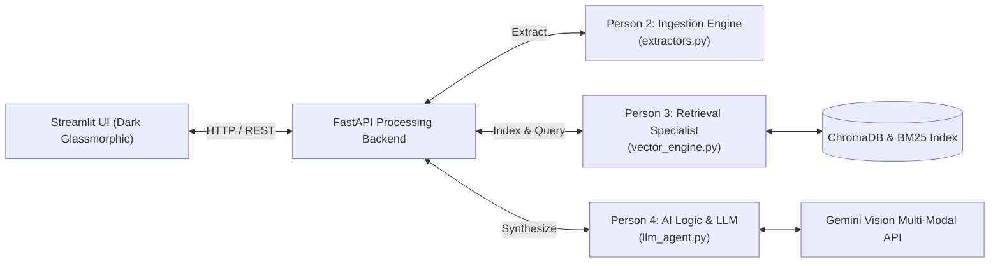

# 🔮 Project Synthexis

**Advanced Multi-Modal Retrieval-Augmented Generation Architecture**

Synthexis is a decoupled multi-modal RAG platform engineered to ingest complex documents (extracting both dense text and visual diagrams/charts), execute hybrid exact-match (BM25) and semantic vector similarity searches, and synthesize cross-document insights using vision-capable Large Language Models (Google Gemini).

---

## 🏛️ System Architecture



---

## 👥 Zero-Conflict Team Protocol & Ownership

To eliminate Git merge conflicts entirely, Project Synthexis strictly enforces **file-level ownership**. No team member modifies a file owned by another. Functions communicate via standardized data contracts:

| Team Member | Role | Files Owned | Workload | Primary Responsibilities |
| :--- | :--- | :--- | :--- | :--- |
| **Yashu Seervi** ([@Astroidkiller](https://github.com/Astroidkiller)) | **Full-Stack Integrator & UI Lead** | `app.py`, `main_api.py`, `style.css` | 30% | Repository skeleton, Docker, FastAPI routing layer, Streamlit dark mode glassmorphism UI, team integration. |
| **Person 2** | **Data Ingestion Engineer** | `extractors.py` | 23.3% | Complex PDF parsing, text chunking (RecursiveCharacterTextSplitter), and embedded chart/table extraction as byte-streams or base64. |
| **Person 3** | **Retrieval & Vector Specialist** | `vector_engine.py` | 23.3% | Dense vector embeddings, ChromaDB collection management, BM25 exact keyword index, and hybrid search routing. |
| **Person 4** | **AI Logic & Synthesis Engineer** | `llm_agent.py` | 23.3% | Gemini API client, strict prompt engineering to eliminate hallucinations, context citation enforcement, and multimodal synthesis. |

---

## 📑 I/O Data Contracts

### Person 2: `extractors.py`
```python
def process_document(file_path: str) -> dict:
    """
    Parses PDF at file_path.
    Returns:
        dict with keys:
            - "text_chunks": list[str] (clean text chunks with page markers)
            - "images": list[str | bytes] (base64 data URIs or image bytes)
    """
```

### Person 3: `vector_engine.py`
```python
def create_index(chunks: list) -> bool:
    """
    Builds ChromaDB vector collection and BM25 index from text chunks.
    Returns: True on success.
    """

def hybrid_search(query: str, top_k: int = 5) -> list:
    """
    Combines BM25 keyword matching with cosine vector similarity.
    Returns: list[str] (top-K most relevant text chunks).
    """
```

### Person 4: `llm_agent.py`
```python
def generate_synthesis(query: str, context: list, images: list = None) -> str:
    """
    Generates cohesive Markdown analysis comparing retrieved context & charts.
    Returns: Markdown string with inline citations.
    """
```

---

## 🚀 Quickstart Guide

### 1. Prerequisites
- Python 3.10+ (or Docker Desktop)
- Google Gemini API Key

### 2. Setup Environment
```bash
# Clone the repository
git clone <repo-url>
cd synthexis_starter_repo

# Copy environment variables
cp .env.example .env
# Edit .env and insert your GEMINI_API_KEY
```

### 3. Install Dependencies
```bash
pip install -r requirements.txt
```

### 4. Running the Application Locally
In two separate terminals:

**Terminal 1 — Start the FastAPI Processing Backend:**
```bash
uvicorn main_api:app --host 127.0.0.1 --port 8000 --reload
```
*API Swagger Docs will be available at: http://127.0.0.1:8000/docs*

**Terminal 2 — Start the Streamlit Frontend UI:**
```bash
streamlit run app.py --server.port 8501
```
*Streamlit UI will be available at: http://localhost:8501*

---

## 🐳 Docker Deployment

To launch the complete decoupled system in containers:
```bash
# Build and run with Docker Compose
docker compose up --build
```
- **Streamlit Frontend:** `http://localhost:8501`
- **FastAPI Backend:** `http://localhost:8000`
- **API Health Check:** `http://localhost:8000/health`

---

## 🛡️ Modular Integration Adapters
The backend architecture includes fallback adapters for submodules during active development. This enables the team to test UI workflows, multi-document ingestion, and query routing end-to-end continuously.
