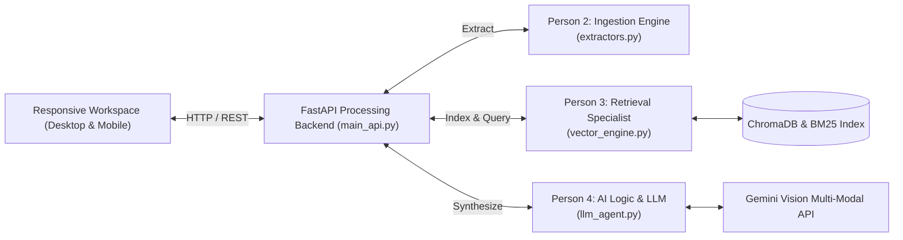

# 🔮 Project Synthexis

**Advanced Multi-Modal Retrieval-Augmented Generation Architecture**

Synthexis is a decoupled multi-modal RAG platform engineered to ingest complex documents (extracting dense text, Markdown tables, and visual diagrams/charts), execute hybrid exact-match (BM25) and semantic vector similarity searches (ChromaDB), and synthesize cross-document insights using vision-capable Large Language Models (Google Gemini).

---

## 🏛️ System Architecture



---

## 👥 Zero-Conflict Team Protocol & Ownership

Project Synthexis strictly enforces **file-level ownership** across the team:

| Team Member | Role | Files Owned | Primary Responsibilities | Status |
| :--- | :--- | :--- | :--- | :--- |
| **Yashu Seervi** ([@Astroidkiller](https://github.com/Astroidkiller)) | **Full-Stack Integrator & UI Lead** | `main_api.py`, `index.html`, `app.py`, `style.css` | System architecture, FastAPI routing layer, responsive desktop & mobile workspace, team integration. | ✅ Complete |
| **Person 2** | **Data Ingestion Engineer** | `extractors.py` | PDF parsing, table extraction, LangChain chunking, and embedded diagram isolation. | ✅ Merged |
| **Person 3** | **Retrieval & Vector Specialist** | `vector_engine.py` | ChromaDB vector storage, BM25Okapi keyword index, and Reciprocal Rank Fusion (RRF). | ✅ Merged |
| **Person 4** | **AI Logic & Synthesis Engineer** | `llm_agent.py` | Google GenAI SDK integration, anti-hallucination prompts, citation tracking (`[C1]`, `[V1]`), and external knowledge fallback. | ✅ Merged |

---

## 🚀 Quickstart Guide (How to Run the Website)

### 1. Prerequisites
- **Python 3.10+** installed
- A **Google Gemini API Key** (from [Google AI Studio](https://aistudio.google.com/))

### 2. Clone & Configure Environment
```bash
git clone https://github.com/Astroidkiller/Synthexis.git
cd Synthexis
```

Create a `.env` file in the project root:
```env
GEMINI_API_KEY=your_actual_gemini_api_key_here
GEMINI_MODEL=gemini-flash-lite-latest
```

### 3. Install Dependencies
```bash
pip install -r requirements.txt
```

---

### 4. Run the Application

You can run Synthexis using either the **FastAPI Backend (Direct Web App)** or the **Streamlit Runner**:

#### Option A: Direct Web App (Recommended)
Run the FastAPI server:
```bash
python -m uvicorn main_api:app --host 127.0.0.1 --port 8000 --reload
```
👉 Open your browser to: **[http://localhost:8000](http://localhost:8000)**
- Immediately serves the unified **Desktop & Mobile responsive workspace** (`index.html`).
- Swagger API documentation is available at **[http://localhost:8000/docs](http://localhost:8000/docs)**.

#### Option B: Streamlit Frontend
If you prefer running via Streamlit:
1. In Terminal 1, start the backend:
   ```bash
   python -m uvicorn main_api:app --host 127.0.0.1 --port 8000
   ```
2. In Terminal 2, start Streamlit:
   ```bash
   streamlit run app.py
   ```
👉 Open your browser to: **[http://localhost:8501](http://localhost:8501)**

---

## 📱 Desktop & Mobile Responsive Preview

The workspace (`index.html`) is **fully responsive** on a single URL:
- **On Desktop (≥ 1024px)**: Multi-column view with fixed left rail, collapsible Document Vault, center Synthesis Canvas, and right Evidence Inspector.
- **On Mobile / DevTools (< 1024px)**: Fluid single-column layout with a mobile hamburger menu, off-canvas sliding drawers for Vault and Evidence, and a bottom navigation bar.

To preview on mobile:
1. Open `http://localhost:8000` in Google Chrome or Microsoft Edge.
2. Press `F12` (or Right-Click → **Inspect**).
3. Toggle the **Device Toolbar** (`Ctrl + Shift + M` / `Cmd + Shift + M`) and select any phone (iPhone, Pixel, Samsung). The workspace automatically adapts with zero horizontal overflow.

---

## 📑 I/O Data Contracts

- `extractors.py`: `process_document(file_path: str) -> dict` with keys `text_chunks` and `images`.
- `vector_engine.py`: `create_index(chunks: list) -> bool` and `hybrid_search(query: str, top_k: int) -> list[str]`.
- `llm_agent.py`: `generate_synthesis(query: str, context: list[str], images: list = None) -> str`.
